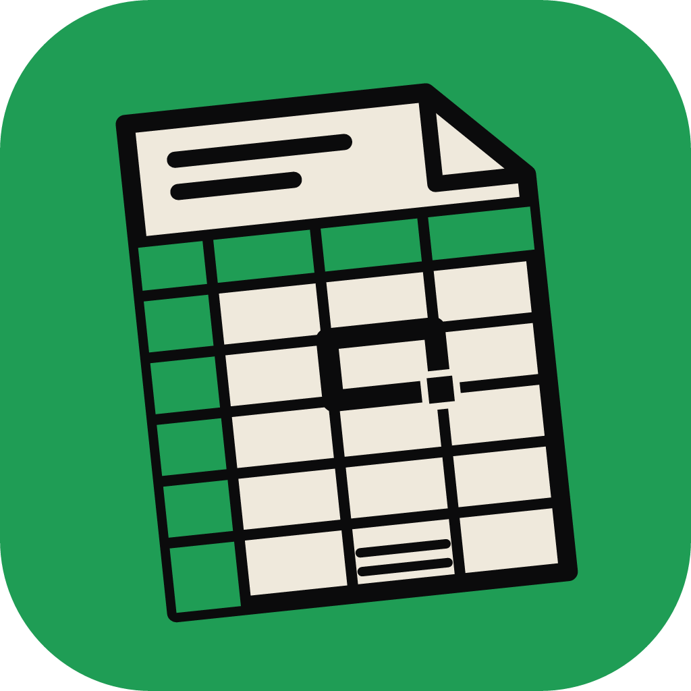

<p align="center">
  
</p>

<h1 align="center">GridCraft for Android</h1>

<p align="center">
  <b>GridCraft-android is an open-source spreadsheet app for Android, built on the same Rust engine, <a href="https://github.com/storytold/gridcraft">GridCraft</a>, as the desktop app, with a Kotlin/Jetpack Compose UI.</b><br>
  Many credits to the original maintainers, <a href="https://github.com/storytold">storytold</a>.
</p>

<p align="center">
  <a href="https://github.com/artcraft-android/gridcraft-android/releases"></a>
  <a href="https://apps.obtainium.imranr.dev/redirect?r=obtainium://add/https://github.com/artcraft-android/gridcraft-android"></a>
</p>

<p align="center">
  
  
  
  
  
  
</p>

<p align="center">
  <a href="#the-sheet">The sheet</a> ·
  <a href="#formats-and-styles">Formats &amp; styles</a> ·
  <a href="#charts-shapes-and-pictures">Charts, shapes &amp; pictures</a> ·
  <a href="#data">Data</a> ·
  <a href="#planned-features">Planned features</a> ·
  <a href="#building-instructions">Building</a> ·
  <a href="#license">License</a>
</p>

<br>

## The sheet

- Opens and saves `.xlsx`, and opens `.xlsm`, `.xltx`, `.xlsb`, `.xls`, `.ods` and `.csv`
  workbooks; keeps what it doesn't edit (pivot caches, rich data, macros) as it found it.
- A light sheet with the formula bar at the bottom, a floating command bar (sheets, Find, Sort &
  Filter, Fill Color, the palette) and the palette's tabs: Home, Insert, Draw, Formulas, Data,
  Review and View, with contextual tabs for tables, charts, shapes, pictures and PivotTables.
- Over 500 functions, dynamic arrays, names, tables with structured references, and Tell Me to
  find any command.
- Drawing with the pen or a finger, comments and notes, freeze panes, outlines, Cards View for
  tables, Share as PDF and printing.

## Formats and styles

- Fonts, sizes, borders as a 12-button grid with line styles and colours, fill and font colours
  in theme and standard colours, alignment, wrap, merge and text direction.
- Number formats with their own pages: negative numbers, currency symbols for every locale,
  accounting, 18 date and 9 time formats, special formats; cell styles as a gallery of tiles.

## Charts, shapes and pictures

- Every chart family of the phone app's gallery, previews drawn from your own data: column,
  line, pie (and pie of pie, bar of pie, doughnut), bar, area, scatter and bubble, each with its
  3-D forms; treemap, sunburst, histogram and Pareto, box and whisker, waterfall, funnel;
  surface and contour, radar.
- The full shapes gallery (lines and connectors, rectangles, basic shapes, block arrows,
  equation shapes, flowchart, stars and banners, callouts), with Change Shape, Shape Styles,
  fill, outline and size.
- Pictures over the cells or in a cell, from the gallery or the camera.

## Data

- Sort and filter: by values, by number or text rules, and by cell colour.
- AutoSum, Insert & Delete, Clear, Find and Select Range; show and hide detail.

## Planned features

- Sheet View and the online features (sharing, co-authoring, data from picture, maps).
- More of the chart tools on the Chart tab.

## Building Instructions
*One Gradle command builds the whole app: it compiles the Rust engine with [cargo-ndk](https://github.com/bbqsrc/cargo-ndk), generates the Kotlin bindings and fetches the open fonts (Carlito, Caladea, Liberation) from pinned sources.*

* Clone this repository
* Make sure you have at least 4 GB of free disk space
* enter `apps/gridcraft-android/android` and run `./gradlew assembleRelease`, or open that folder in Android Studio and press Run.

Build time dependencies:

<details>
  <summary>required tools</summary>

  ```
      rustup (it installs the Rust release and Android targets rust-toolchain.toml names)
      cargo install cargo-ndk --version 4.1.2 --locked
      Android SDK (API 37) and NDK 29.0.14206865
      JDK 17 or newer
  ```
</details>

## License

GridCraft for Android is licensed under the MIT License or the Apache License, Version 2.0, at
your option (`LICENSE-MIT`, `LICENSE-APACHE`). Third-party material is listed in `NOTICE` and
`ATTRIBUTION.md`.

GridCraft for Android is not affiliated with or endorsed by Microsoft.
